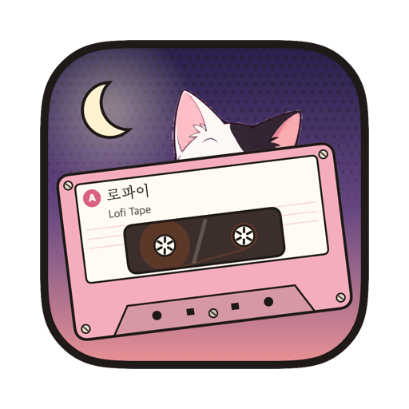
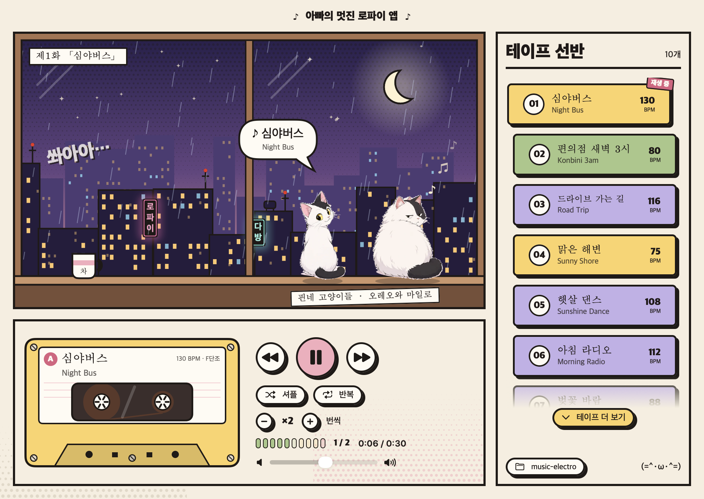
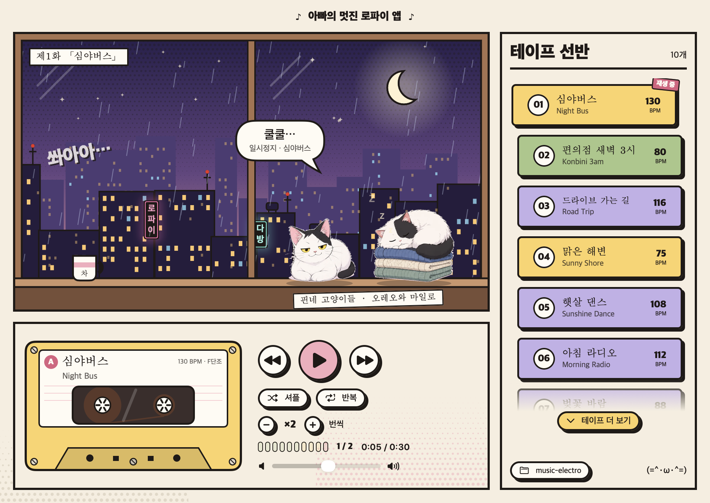

<p align="center"></p>

# Korean Jukebox

A little Mac jukebox, 아빠의 멋진 로파이 앱 ("Dad's Cool Lofi App"), that plays lo-fi loops made for games. Oreo and Milo, the Finn cats, sit on the windowsill watching a rainy city and bounce along in time to whatever's playing, then curl up and doze when it's paused. All the writing in the app is Korean, with each tape's English name underneath.

The music is synthesised in Python. There are no samples: every drum, chord and melody is generated, so each track is a script you can change and re-render, and every loop is seamless so it drops straight into a game.





## Running the jukebox

```
cd jukebox
./build.sh
open "build/Lofi Jukebox.app"
```

It needs macOS 14 or later and Xcode 16 or later. The tapes are already rendered in `out/`, so it plays straight away and picks up anything you render later. [jukebox/README.md](jukebox/README.md) explains how it works.

## Making tracks

```
python3 -m venv .venv
.venv/bin/pip install -r requirements.txt
```

## Rendering

```
.venv/bin/python render.py                      # every track
.venv/bin/python render.py night_bus --preview  # also writes three loops back to back to out/preview
.venv/bin/python render.py night_bus --levels   # loudness of each part relative to the mix
```

Each track lands in `out/` as a WAV and an OGG.

## Using the loops in a game

- The WAV is 16-bit 44.1 kHz with a `smpl` chunk marking the whole file as a loop. Godot (Loop Mode: Detect From WAV), FMOD and Wwise pick it up.
- The OGG Vorbis is about a seventh of the size and the exact same length, so it loops without a gap too. Use it for builds.
- Don't convert to MP3. The encoder pads silence onto the start and end, which puts a gap in the loop.
- Every track is mastered to -16 LUFS with peaks under -1 dBFS, so they sit at the same level when the game switches between them.

## How the loops stay seamless

Each track is built on exactly one loop's worth of buffer. Anything that runs past the end (a reverb tail, a held note, a delay echo) wraps round to the start, as it would if the loop had already been playing. Filters run over two copies of the loop and keep the second, and the tape wobble does a whole number of cycles per loop, so the last sample leads straight into the first.

## Layout

- `lofi/dsp.py`: oscillators, envelopes, filters, loop-safe reverb, delay, tape wobble, sidechain and mastering
- `lofi/inst.py`: drum voices, electric piano, pad, bass, vocal chops, plucked strings (Karplus-Strong), organ, brass, flute, melodica, marimba, chip leads, and textures for vinyl, rain, waves and train rumble
- `lofi/song.py`: the 16th-note grid with swing, and buses that wrap at the loop end
- `tracks/`: one file per loop. Copy one to start a new track.

## Turning a recording into a track

Drop any audio or video file into `inbox/` (a Voice Memos `.m4a` is fine) and the tune in it can be played by instruments. `lofi/recording.py` loads it through ffmpeg, finds the phrases at the breaths, works out the tempo, tuning and key, and `transcribe` turns each phrase into notes on a 16th-note grid, one per syllable, snapped to the scale. `tracks/best.py` shows the result: the notes live in a table in the track file, so the recording isn't needed to render it and the tune can be tidied by hand.

## Tracks

| Track | Korean title | Style | BPM | Key | Bars | Length |
| --- | --- | --- | --- | --- | --- | --- |
| night_bus | 심야버스 | Lo-fi 2-step garage | 130 | F minor | 16 | 29.5s |
| konbini | 편의점 새벽 3시 | Lo-fi hip hop with rain | 80 | D dorian | 16 | 48.0s |
| road_trip | 드라이브 가는 길 | Lo-fi folk pop, strummed guitars and whistling | 116 | D major | 16 | 33.1s |
| sunny_shore | 맑은 해변 | Lo-fi reggae, one drop and dub echoes | 75 | G major | 16 | 51.2s |
| sunshine_dance | 햇살 댄스 | Lo-fi afrobeats with highlife guitar and horns | 108 | A major | 16 | 35.6s |
| morning_radio | 아침 라디오 | Bouncy platformer tune through a kitchen radio | 112 | C major | 16 | 34.3s |
| sakura_drift | 벚꽃 바람 | Lo-fi with koto and bamboo flute | 88 | D minor (in scale) | 16 | 43.6s |
| neon_chase | 네온 추격전 | Lo-fi liquid drum and bass | 172 | E minor | 32 | 44.7s |
| rooftop_arcade | 옥상 오락실 | Lo-fi house with filtered organ | 122 | A minor | 16 | 31.5s |
| best | 최고야 | Lo-fi hip hop on a tune transcribed from a voice memo | 72 | A major | 12 | 40.0s |
